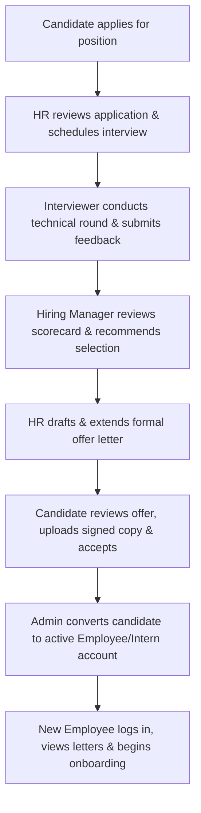
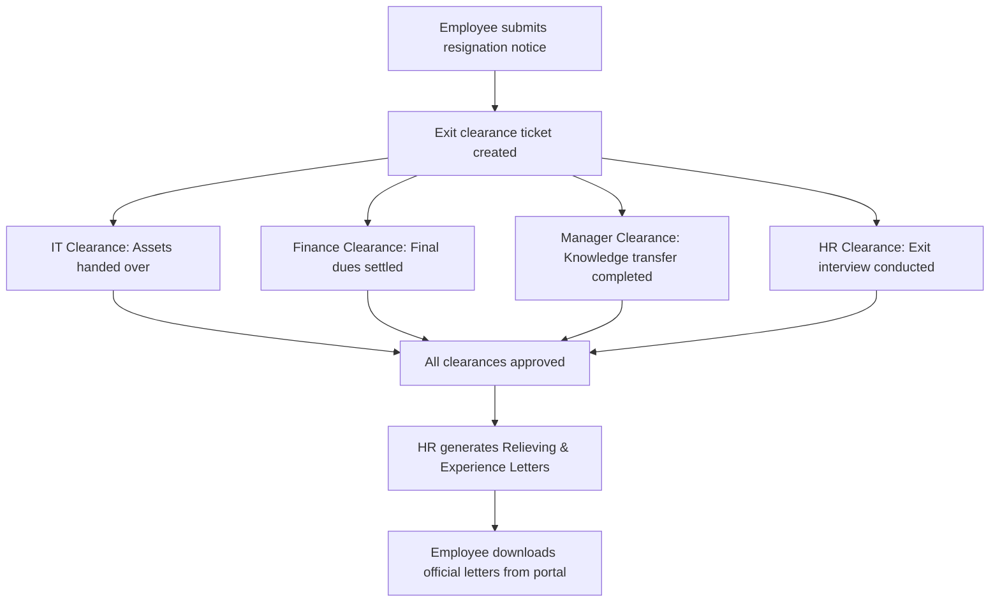

# PeopleOps HR Internal Operations Platform — Unified User Guide & Role Manual

Welcome to the **PeopleOps HR Platform** comprehensive user guide. This document provides an end-to-end operational guide for all **7 user roles** supported by the platform, complete with **pre-seeded demo credentials**, feature walkthroughs, UI navigation paths, and cross-functional workflows.

---

## Table of Contents
1. [Platform Overview & Quick Start](#1-platform-overview--quick-start)
2. [Master Demo Accounts & Credentials Cheat Sheet](#2-master-demo-accounts--credentials-cheat-sheet)
3. [Role Guides](#3-role-guides)
   - [3.1 System Administrator (`admin`)](#31-system-administrator-admin)
   - [3.2 HR Operations (`hr`)](#32-hr-operations-hr)
   - [3.3 Hiring Manager (`hiring_manager`)](#33-hiring-manager-hiring_manager)
   - [3.4 Technical Interviewer (`interviewer`)](#34-technical-interviewer-interviewer)
   - [3.5 Full-Time Employee (`employee`)](#35-full-time-employee-employee)
   - [3.6 Intern (`intern`)](#36-intern-intern)
   - [3.7 Candidate / Job Applicant (`candidate`)](#37-candidate--job-applicant-candidate)
4. [End-to-End System Workflows](#4-end-to-end-system-workflows)
   - [Recruitment to Onboarding Flow](#recruitment-to-onboarding-flow)
   - [Employee Resignation & Exit Clearance Flow](#employee-resignation--exit-clearance-flow)
5. [Troubleshooting & Common FAQs](#5-troubleshooting--common-faqs)

---

## 1. Platform Overview & Quick Start

PeopleOps is an enterprise HR and operations platform that manages the complete employee lifecycle—from candidate application, interviews, and offer management to onboarding, document handling, career history, and exit clearance.

### Running the Application

1. **Start Backend Server**:
   ```bash
   cd backend
   npm run dev
   # Runs on http://localhost:5000
   ```

2. **Start Frontend Client**:
   ```bash
   cd frontend
   npm run dev
   # Runs on http://localhost:5173
   ```

3. **Seeding / Resetting Demo Accounts in Database**:
   If the database is clean or demo accounts need to be reset, execute:
   ```bash
   cd backend
   node createDemoAccounts.js
   ```
   This seeds all 7 active demo accounts, configures reporting hierarchies, pre-loads a candidate application with a scheduled technical interview, and provisions letter templates and approval workflows.

4. **Signing In**:
   - Navigate to `http://localhost:5173/login`.
   - You can enter the credentials manually or click any of the **Quick Demo Login chips** at the bottom of the sign-in card.

---

## 2. Master Demo Accounts & Credentials Cheat Sheet

The following demo accounts are seeded directly in the MongoDB database (`users` collection). Each account has `isActive: true`, `status: "active"`, and `isEmailVerified: true`.

| Role | Persona Name | Email | Password | Department / Track | Default Route |
| :--- | :--- | :--- | :--- | :--- | :--- |
| **Admin** | System Admin | `admin@company.com` | `Admin@12345` | Administration | `/admin` |
| **HR** | HR Operations | `hr@company.com` | `HR@12345` | Human Resources | `/hr` |
| **Hiring Manager** | Alex Rivera | `manager@company.com` | `Manager@123` | Engineering | `/hiring-manager` |
| **Interviewer** | Sarah Chen | `interviewer@company.com` | `Interviewer@123` | Engineering | `/interviewer` |
| **Employee** | David Miller | `employee@company.com` | `Employee@123` | Engineering (Senior Engineer) | `/employee` |
| **Intern** | Emily Watson | `intern@company.com` | `Intern@123` | Engineering (Backend Track) | `/intern` |
| **Candidate** | John Doe | `candidate@company.com` | `Candidate@123` | Engineering (Software Engineer) | `/candidate` |

> [!TIP]
> On the login page (`/login`), clicking any role badge at the bottom instantly populates the credentials and logs you directly into that role workspace.

---

## 3. Role Guides

---

### 3.1 System Administrator (`admin`)

**Primary Focus**: System-wide governance, user access management, pipeline overrides, employee record conversions, letter templates, and compliance audit logs.

- **Login**: `admin@company.com` / `Admin@12345`
- **Portal URL**: `/admin`
- **Key Navigation & Features**:
  1. **Omnibar Global Search (`Ctrl + K` or `Cmd + K`)**:
     - Instant modal search across all users, candidates, and employees by name or email.
     - Direct jump navigation into specific user profiles or recruitment status views.
  2. **Dashboard Overview**:
     - High-level KPI metric tiles: Total Users, Active Employees, Pipeline Candidates, Open Roles.
     - Pipeline stage distribution charts and quick-action filters.
  3. **User Management (`Users` Tab)**:
     - View all registered platform users across all 7 roles.
     - Filter by role (`admin`, `hr`, `hiring_manager`, `interviewer`, `employee`, `intern`, `candidate`) or status (`active`, `inactive`).
     - Create new accounts, edit profiles, toggle active status, and trigger password resets.
  4. **Recruitment Pipeline Management (`Recruitment` Tab)**:
     - Review candidate progress through all stages: `applied`, `interview`, `selected`, `offer_sent`, `accepted`, `rejected`.
     - Administrative status overrides: Force-advance or adjust candidate stages when necessary.
  5. **Employee Directory & Conversion (`Employees` Tab)**:
     - Directory of all confirmed staff members with detailed contact and employment info.
     - **Accepted Offers Queue**: Convert candidates who accepted their offer letters into active `employee` or `intern` accounts.
  6. **Templates & Workflows (`Templates` Tab)**:
     - Manage HTML letter templates for Offers, Appointments, Relieving, and Experience letters.
     - Define approval chains (e.g., Hiring Manager Review &rarr; HR Head &rarr; Executive Sign-Off).
  7. **Audit Logs & Compliance (`Audit Logs` Tab)**:
     - Immutable records of system activities: logins, role changes, salary modifications, offer creations, and status overrides.
     - Filter by actor, action type, date range, or IP address.
     - One-click export to **CSV** or **JSON**.

---

### 3.2 HR Operations (`hr`)

**Primary Focus**: Daily human resources workflows, hiring operations, interview scheduling, issuing offers, onboarding coordination, and exit settlements.

- **Login**: `hr@company.com` / `HR@12345`
- **Portal URL**: `/hr`
- **Key Navigation & Features**:
  1. **Overview Dashboard (`/hr/dashboard`)**:
     - HR metrics: Headcount, open positions, pending candidate evaluations, upcoming joining dates.
     - One-click export utility for HR operational reports.
  2. **Candidate Management (`/hr/candidates`)**:
     - List of applicants with status badges, applied dates, and uploaded resumes.
     - Move candidates across stages, request documents, or trigger offer creation.
  3. **Interview Operations (`/hr/interviews`)**:
     - Schedule new interview rounds for applicants.
     - Assign internal technical interviewers (e.g., Sarah Chen).
     - Set date, time, interview type (`technical`, `hr`, `managerial`), and meeting links (e.g., Google Meet).
     - Monitor interview completion and feedback status.
  4. **Offer Generation & Tracking (`/hr/offers`)**:
     - Draft formal offer letters specifying position, CTC, joining date, and document requirements.
     - Route offers through configured approval workflows.
     - Track offer statuses: `draft` &rarr; `pending_approval` &rarr; `approved` &rarr; `sent` &rarr; `accepted`.
  5. **Employee Directory (`/hr/employees`)**:
     - Comprehensive master list of active employees.
     - Inspect designations, departments, compensation tiers, and emergency contacts.
  6. **Intern Management (`/hr/interns`)**:
     - Dedicated view for interns tracking mentors, stipend details, tracks, and program start/end dates.
     - Facilitate full-time employment conversion upon internship conclusion.
  7. **Document & Letter Management (`/hr/documents`, `/hr/letters`)**:
     - Review uploaded candidate and employee verification documents.
     - Issue formal company letters (Appointment Letters, Promotion Letters, Increments).
  8. **Onboarding Checklists (`/hr/onboarding`)**:
     - Assign and track onboarding task lists for incoming new hires.
  9. **Exit Management (`/hr/exits`)**:
     - Manage employee resignation requests.
     - Coordinate multi-department clearances across **IT, Finance, Manager, and HR**.
     - Issue and sign Relieving Letters and Experience Certificates upon clearance completion.

---

### 3.3 Hiring Manager (`hiring_manager`)

**Primary Focus**: Talent assessment, interview feedback review, and final hiring recommendations for team openings.

- **Login**: `manager@company.com` / `Manager@123`
- **Portal URL**: `/hiring-manager`
- **Key Navigation & Features**:
  1. **Hiring Dashboard (`Overview` Tab)**:
     - Real-time departmental metrics: Active Open Roles, Candidates in Pipeline, Interviews This Week.
     - Recent applicant feeds with immediate visibility into interview ratings.
  2. **Pending Reviews (`Pending Review` Tab)**:
     - Queue of candidates who have completed technical interview rounds and await hiring manager decisions.
     - Click **Review** on any candidate to inspect:
       - Full applicant resume.
       - Detailed scorecard and ratings left by technical interviewers.
  3. **Recommendation Modal**:
     - Submit hiring decisions:
       - **Select**: Recommend candidate for formal offer generation.
       - **Reject**: Archive application with feedback.
     - Enter mandatory justification comments/notes to maintain an audit trail.
  4. **Decisions History (`Decisions` Tab)**:
     - Historical log of all accepted and rejected candidate recommendations submitted by the manager.

---

### 3.4 Technical Interviewer (`interviewer`)

**Primary Focus**: Conducting technical assessments, grading skills, and submitting structured evaluations.

- **Login**: `interviewer@company.com` / `Interviewer@123`
- **Portal URL**: `/interviewer`
- **Key Navigation & Features**:
  1. **Interviews Dashboard**:
     - Filter tabs: **Upcoming**, **Today**, and **Completed**.
     - View applicant name, target role, scheduled date/time, and meeting link.
  2. **Conducting the Interview**:
     - Click the meeting link directly from the card to launch the interview session.
     - Access candidate resume and application notes.
  3. **Structured Evaluation Modal**:
     - Click **Evaluate / Feedback** on any scheduled round to launch the scorecard dialog.
     - Form components:
       - **Numerical Score**: 0 to 100 rating.
       - **Star Rating**: 1 to 5 stars.
       - **Qualitative Feedback**: Structured comments detailing technical strengths, areas for improvement, and overall hiring fit.
     - **Draft vs. Final Submission**:
       - *Save Draft*: Temporarily store evaluation notes without marking the round complete.
       - *Complete Interview*: Finalizes the assessment, marks the interview as `completed`, and notifies the Hiring Manager and HR.

---

### 3.5 Full-Time Employee (`employee`)

**Primary Focus**: Self-service portal for personal records, career history, compensation details, company letters, and exit processing.

- **Login**: `employee@company.com` / `Employee@123`
- **Portal URL**: `/employee`
- **Key Navigation & Features**:
  1. **Overview (`/employee`)**:
     - Employee profile summary card displaying Name, Employee ID (`DEMO-EMP-001`), Designation, Department, and Date of Joining.
  2. **Personal Profile (`/employee/profile`)**:
     - View and edit contact phone number, personal address, and emergency contact details.
  3. **Career History (`/employee/history`)**:
     - Timeline tracing designations, promotions, and departmental milestones within the organization.
  4. **Salary & Compensation (`/employee/salary`)**:
     - Breakdown of CTC, base pay, allowances, and compensation history.
  5. **Documents Repository (`/employee/documents`)**:
     - View verified onboarding files (ID proof, academic records, signed contracts).
     - Upload additional or updated documents when requested by HR.
  6. **Company Letters (`/employee/letters`)**:
     - View and download all official corporate letters in **PDF format**:
       - Offer Letter
       - Appointment Letter
       - Promotion / Increment Letters
  7. **Resignation & Exit (`/employee/resignation`)**:
     - Submit formal resignation notice with reason and preferred last working day.
     - Live progress tracker for 4 departmental clearance gates:
       - IT Clearance (Asset handover)
       - Finance Clearance (Dues & expense settlement)
       - Manager Clearance (Knowledge transfer)
       - HR Clearance (Exit interview & full-and-final settlement)
     - Download generated Relieving Letter and Experience Letter once approved.

---

### 3.6 Intern (`intern`)

**Primary Focus**: Dedicated self-service workspace tailored for interns to monitor track milestones, onboarding checklists, mentor guidance, and agreements.

- **Login**: `intern@company.com` / `Intern@123`
- **Portal URL**: `/intern`
- **Key Navigation & Features**:
  1. **Internship Overview (`/intern`)**:
     - Tracks current internship domain (e.g., Software Engineering - Backend Track).
     - Assigned Mentor details (linked to Hiring Manager Alex Rivera).
     - Duration counter with Start Date and End Date.
     - Monthly stipend display.
  2. **Profile (`/intern/profile`)**:
     - Personal contact details and university/college information.
  3. **Onboarding Checklist (`/intern/onboarding`)**:
     - Step-by-step onboarding milestones: system setup, orientation sessions, security guidelines.
  4. **Internship Documents (`/intern/documents`)**:
     - Upload required academic NOC, university letters, photo identification, and signed internship agreements.
     - Review HR verification statuses (`pending`, `verified`, `rejected`).
  5. **Offer View (`/intern/offer`)**:
     - Reference copy of initial internship terms and compensation details.

---

### 3.7 Candidate / Job Applicant (`candidate`)

**Primary Focus**: Transparency portal for applicants to track application stages, attend interviews, review job offers, and submit acceptance documentation.

- **Login**: `candidate@company.com` / `Candidate@123`
- **Portal URL**: `/candidate`
- **Key Navigation & Features**:
  1. **Application Tracker (`/candidate/application`)**:
     - Visual stage tracker illustrating real-time recruitment progression:
       $$\text{Applied} \longrightarrow \text{Interview} \longrightarrow \text{Selected} \longrightarrow \text{Offer Sent} \longrightarrow \text{Accepted}$$
     - Review submitted resume and application metadata.
  2. **Interview Schedules**:
     - Inspect upcoming interview details, scheduled timings, and Google Meet video links.
  3. **Offer Letter Review & Acceptance (`/candidate/offer`)**:
     - Activated once HR extends an official offer.
     - Displays offered job title, department, annualized CTC, and anticipated joining date.
     - **Download Official Offer PDF** to read formal terms.
     - **Acceptance Submission**:
       - Upload signed copy of the offer letter.
       - Upload mandatory onboarding documents (e.g., Degree Certificate, Government ID).
       - Add optional notes and click **Accept Offer** (or **Decline Offer**).
     - Once accepted, HR and Admin are alerted to convert the applicant into an Employee.
  4. **Candidate Documents (`/candidate/documents`)**:
     - Manage and upload supplementary credentials, certificates, or portfolios.

---

## 4. End-to-End System Workflows

### Recruitment to Onboarding Flow



1. **Scheduling**: Log in as `hr@company.com` &rarr; go to `/hr/interviews` &rarr; schedule interview for candidate `candidate@company.com` assigned to `interviewer@company.com`.
2. **Evaluation**: Log in as `interviewer@company.com` &rarr; go to `/interviewer` &rarr; open the candidate round &rarr; submit rating and complete feedback.
3. **Recommendation**: Log in as `manager@company.com` &rarr; go to `/hiring-manager` &rarr; click **Review** under **Pending Reviews** &rarr; select candidate with approval comments.
4. **Offer Generation**: Log in as `hr@company.com` &rarr; go to `/hr/offers` &rarr; generate and issue offer to candidate.
5. **Acceptance**: Log in as `candidate@company.com` &rarr; go to `/candidate/offer` &rarr; review offer details &rarr; upload signed PDF &rarr; click **Accept Offer**.
6. **Conversion**: Log in as `admin@company.com` &rarr; go to `/admin` &rarr; select **Employees** tab &rarr; view **Accepted Offers** &rarr; convert into active **Employee**.

---

### Employee Resignation & Exit Clearance Flow



1. **Resignation**: Employee (`employee@company.com`) navigates to `/employee/resignation` &rarr; submits resignation with reason and expected last working day.
2. **Departmental Clearance**: HR (`hr@company.com`) opens `/hr/exits` &rarr; marks status for IT, Finance, Manager, and HR clearances.
3. **Settlement & Closure**: Once all 4 gates show approved, HR marks the exit as completed.
4. **Letter Retrieval**: Employee downloads official Relieving and Experience letters directly from their portal.

---

## 5. Troubleshooting & Common FAQs

### 1. "Invalid email or password" on Login
- Ensure you have executed `node backend/createDemoAccounts.js` to ensure the database contains the exact password hashes.
- Remember passwords are case-sensitive (e.g., `Admin@12345`, `HR@12345`, `Manager@123`).
- Use the 1-click **Quick Demo Login** badges on the login screen to sign in without typing errors.

### 2. Role Mismatch Error
- If you manually type an email into the login screen while a different role is explicitly selected in the dropdown, the system prevents cross-role logins.
- Select **Auto-detect Role** or clear the role dropdown before logging in.

### 3. Session Expiration
- JWT authentication tokens are saved in browser `localStorage` (`hr-auth-token`).
- If requests fail with `401 Unauthorized`, click **Sign Out** and log back in to renew your token.

### 4. Backend Connection / CORS Errors
- Confirm backend is running on `http://localhost:5000` with `npm run dev` in `backend/`.
- Ensure `frontend/.env` contains:
  ```env
  VITE_BACKEND_URL=http://localhost:5000
  VITE_API_URL=http://localhost:5000/api/v1
  ```
- Check that `PORT=5000` is specified in `backend/.env`.

---

*Documentation maintained by the PeopleOps Engineering Team.*
